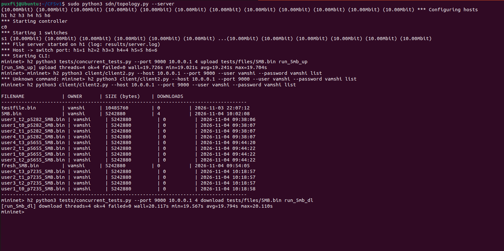

# CFSv1 — Concurrent File Sharing over TLS with SDN Control

A multi-user file-sharing system where many clients upload and download files at the same time over TCP/TLS, while a Software-Defined Network (Mininet + a Ryu OpenFlow controller) enforces access policies and measures bandwidth.

- **File server** — threaded TLS server on port 9000: `LOGIN`, `REGISTER`, `LIST`, `UPLOAD`, `DOWNLOAD`, SHA-256 verification on both sides, per-file metadata, authenticated access.
- **SDN** — Mininet topology (one switch, six hosts, 10 Mbps links) plus a Ryu controller that turns `sdn/policy.json` into OpenFlow rules, **reloads the file live**, and logs per-port bandwidth to CSV.
- **Clients and tests** — a CLI client, an interactive client, and a concurrent test tool that runs N simultaneous transfers and records every one.

---

## Contents

1. [Architecture](#architecture)
2. [Prerequisites](#prerequisites)
3. [Setup](#setup)
4. [Run the full demo (Mininet)](#run-the-full-demo-mininet)
5. [Run without Mininet (localhost)](#run-without-mininet-localhost)
6. [Command reference](#command-reference)
7. [SDN policy](#sdn-policy)
8. [Protocol and data formats](#protocol-and-data-formats)
9. [Project layout](#project-layout)
10. [Troubleshooting](#troubleshooting)
11. [Limitations](#limitations)

---

## Architecture

```
            Ryu controller (OpenFlow 1.3, TCP 6653)
            policy.json -> flow rules | port stats -> bandwidth.csv
                              |
                              | OpenFlow
                              v
   h2 --+
   h3 --+                                  +-- h1  file server (TLS, TCP 9000)
   h4 --+---- s1 (Open vSwitch) -----------+       10.0.0.1
   h5 --+      10 Mbps links
   h6 --+   clients 10.0.0.2 - 10.0.0.6
```

| Host | IP | Switch port | Role |
|------|----|-------------|------|
| h1 | 10.0.0.1 | 1 | File server |
| h2 – h6 | 10.0.0.2 – 10.0.0.6 | 2 – 6 | Clients (**h4 is denied** by the default policy) |

| Port | Protocol | Used by |
|------|----------|---------|
| 9000 | TCP + TLS | File server on h1 |
| 6653 | TCP (OpenFlow 1.3) | Ryu controller; the switch connects to it |

Hosts in Mininet share the machine's file system, so all commands below are run **from the project root**; the test tool gives every thread its own temporary download folder for this reason.

---

## Prerequisites

- Linux with `sudo` (Mininet needs Linux; on Windows or macOS use an Ubuntu VM)
- Mininet and Open vSwitch (system packages)
- Python 3.9 for the Ryu virtual environment (Ryu is old and breaks on newer Pythons)
- `openssl`, `git`

The server, clients and tests use **only the Python standard library** (3.8+). The only pip dependencies are Ryu and its pinned helpers, and they live in the virtual environment.

---

## Setup

Run everything from the project root unless stated otherwise.

### 1. Clone

```bash
git clone https://github.com/CNJackfruit/CFSv1.git
cd CFSv1
```

### 2. Install Mininet and Open vSwitch

```bash
sudo apt update
sudo apt install -y mininet openvswitch-switch
sudo mn --version
```

Mininet is installed system-wide and run with `sudo python3`, so it does **not** go in the virtual environment.

### 3. Create the Ryu virtual environment

```bash
python3.9 -m venv ryu-env
source ryu-env/bin/activate

pip install --upgrade pip
pip install eventlet==0.30.2                    # must be installed before ryu
pip install "setuptools==57.5.0" wheel pbr      # old setuptools: ryu's setup.py needs it
pip install --no-build-isolation ryu==4.34

ryu-manager --version                           # expect: ryu-manager 4.34
```

Why these extra steps: with a current `setuptools`, a plain `pip install ryu` fails with `AttributeError: ... no attribute 'get_script_args'` (`ERROR: Failed to build 'ryu'`). Building against `setuptools==57.5.0` without build isolation avoids it. Keep `pbr` in the install line and pin `ryu==4.34`; otherwise pip can silently fall back to a very old release of Ryu (2.2) that cannot run this controller.

If your distribution has no Python 3.9 package, [`uv`](https://docs.astral.sh/uv/) can fetch one: replace the first line with `uv venv --seed --python 3.9 ryu-env`. If you already have a working Ryu environment (`ryu-manager --version` works), you can skip this step.

`ryu-env/` is already in `.gitignore`.

### 4. Create the TLS certificate

The server loads `server.crt` and `server.key` from the **current directory**. They are git-ignored, so every fresh clone must create them:

```bash
openssl req -x509 -newkey rsa:2048 -nodes \
  -keyout server.key -out server.crt -days 365 -subj "/CN=localhost"
```

### 5. Create the test files

`*.bin` files are git-ignored. Generate random test data (1, 5, 10 and 50 MB) into `tests/files/`:

```bash
python3 tests/make_files.py              # all sizes
python3 tests/make_files.py --sizes 5    # only 5MB.bin
```

### 6. User accounts

`users.json` ships with an account `vamshi` (password `vamshi`), which the concurrent test tool uses. To create more accounts, run `python3 client/client.py` and choose **Register** (the server also accepts a `REGISTER` command directly).

---

## Run the full demo (Mininet)

You need two terminals, both in the project root.

> **Order matters.** `sudo mn -c` also kills any running `ryu-manager`, so run it **before** starting the controller, never after.

### Terminal 1 — controller

```bash
sudo mn -c                        # clean leftovers from any previous run
source ryu-env/bin/activate
ryu-manager sdn/controller.py
```

Expect `Policy loaded from .../sdn/policy.json`, then, once the switch connects, `Switch 1 connected` followed by the installed rules. (A `Switch None disconnected` line at start-up is harmless.) Bandwidth lines (`s1 port 2 (h2): rx ... tx ...`) appear while traffic flows.

### Terminal 2 — Mininet and the file server

```bash
sudo python3 sdn/topology.py --server
```

This builds the topology and starts the file server on h1 (log: `results/server.log`). Wait for the `mininet>` prompt.

### Run the tests

Type these **at the `mininet>` prompt**, without the `mininet>` prefix (pasting the prompt too produces `*** Unknown command: mininet> ...`).

**1. Connectivity check** (ping is always allowed; only TCP to port 9000 is policy-controlled):

```
pingall
```

**2. Concurrent upload** — four simultaneous clients on h2, each uploading the 5 MB file under a unique name:

```
h2 python3 tests/concurrent_tests.py --port 9000 10.0.0.1 4 upload tests/files/5MB.bin run_5mb_up
```

**3. Verify the server's file registry:**

```
h2 python3 client/client2.py --host 10.0.0.1 --port 9000 --user vamshi --password vamshi list
```

**4. Concurrent download** — four simultaneous clients downloading `5MB.bin` (uploaded automatically first as an untimed set-up step), each hash-checked:

```
h2 python3 tests/concurrent_tests.py --port 9000 10.0.0.1 4 download tests/files/5MB.bin run_5mb_dl
```

Each test prints one summary line. A good run looks like this (4 clients share one 10 Mbps server link, so about 20 s for 4 x 5 MB):

```
[run_5mb_up] upload threads=4 ok=4 failed=0 wall=19.726s min=19.021s avg=19.241s max=19.704s
[run_5mb_dl] download threads=4 ok=4 failed=0 wall=20.117s min=19.567s avg=19.794s max=20.110s
```

`failed=0` means every transfer completed and its SHA-256 matched. The command exits non-zero if any transfer failed.




### Try the SDN features

**Spread the load across hosts** (the controller then sees different source IPs; use the same tag everywhere):

```
h2 python3 tests/concurrent_tests.py 10.0.0.1 4 download tests/files/5MB.bin E2_N16 &
h3 python3 tests/concurrent_tests.py 10.0.0.1 4 download tests/files/5MB.bin E2_N16 &
h5 python3 tests/concurrent_tests.py 10.0.0.1 4 download tests/files/5MB.bin E2_N16 &
h6 python3 tests/concurrent_tests.py 10.0.0.1 4 download tests/files/5MB.bin E2_N16 &
```

**A denied client times out.** The default policy denies 10.0.0.4 (h4). Its connection attempt is dropped by the switch, and the client reports `connection timed out (blocked by network policy?)` after 5 s:

```
h4 python3 client/client2.py --host 10.0.0.1 --port 9000 --user vamshi --password vamshi list
```

**Live policy edit** (no restart): while a transfer runs, edit `sdn/policy.json` (for example add `{"id": 0, "action": "deny", "src_ip": "10.0.0.2"}` as the first rule) and save. Within about 2 s the controller logs `Policy reloaded at HH:MM:SS` and h2 is blocked. Remove the rule and access returns. A syntactically broken file is rejected with a warning and the old policy stays active. Inspect what the switch actually holds with:

```
sh ovs-ofctl -O OpenFlow13 dump-flows s1
```

Other useful checks: `iperf h1 h2` (about 9 – 10 Mbps with `--bw 10`).

### Shut down

```
exit
```

Then press `Ctrl+C` in Terminal 1 and run `sudo mn -c`.

---

## Run without Mininet (localhost)

Useful for debugging the server and clients without the network layer. No SDN policy applies here.

```bash
# Terminal 1 (project root; needs server.crt and server.key from setup step 4)
python3 server/server.py --port 9000

# Terminal 2
python3 client/client2.py --host 127.0.0.1 --port 9000 --user vamshi --password vamshi list
python3 client/client2.py --host 127.0.0.1 --port 9000 --user vamshi --password vamshi upload tests/files/1MB.bin
python3 client/client2.py --host 127.0.0.1 --port 9000 --user vamshi --password vamshi download 1MB.bin --dest downloads

python3 tests/concurrent_tests.py --port 9000 127.0.0.1 4 upload   tests/files/5MB.bin local_up
python3 tests/concurrent_tests.py --port 9000 127.0.0.1 4 download tests/files/5MB.bin local_dl
```

Start the server from the project root: it reads `server.crt`, `server.key` and `metadata.json` relative to the current directory.

---

## Command reference

### `server/server.py`

| Option | Default | Meaning |
|--------|---------|---------|
| `--port` | `9000` | TCP port to listen on |
| `--storage` | `database` | Storage folder. Only the folder **name** is used, and it is created inside the project root (`--storage server/storage` stores files in `<root>/storage/`) |

`topology.py --server` starts the server with `--storage server/storage`, so files uploaded in the Mininet demo land in `storage/` at the project root.

### `client/client2.py` (CLI client)

```
python3 client/client2.py --host H --port P --user U --password PW  <command>
```

| Command | Description |
|---------|-------------|
| `list` | Show every file with owner, size, download count and upload time |
| `upload FILE` | Upload a file (64 KB chunks; SHA-256 computed before the timer starts) |
| `download NAME [--dest DIR]` | Download to a temp file, verify SHA-256, then rename. `--dest` defaults to `.` |

Failures print a one-line message and exit with code 1. Each transfer appends a row to `./transfers.csv` (`timestamp,operation,filename,bytes,seconds,mbps`).

### `client/client.py` (interactive client)

A menu-driven client (Login / Register, then Upload / List / Download). It connects to `0.0.0.0:9000` (constants at the top of the file) and saves downloads in `client_downloads/`.

### `tests/concurrent_tests.py`

```
python3 tests/concurrent_tests.py [--port 9000] HOST THREADS {upload|download} FILE TAG
```

One process, N threads. Each thread opens its own connection, logs in, waits on a barrier so all threads start together, then performs one transfer. Uploads use unique names (`user<n>_t<i>_p<pid>_<file>`); downloads use one folder per thread.

| Option | Default | Meaning |
|--------|---------|---------|
| `--port` | `9000` | Server port |
| `--csv` | `results/transfers.csv` | CSV to append one row per transfer to |
| `--name` | derived from IP (`h2`...) | Value for the `host` column |
| `--barrier-timeout` | `60` | Seconds to wait for all threads to be ready |
| `--keep` | off | Keep the temp/download folders |

### `tests/make_files.py`

`--sizes 1 5 10 50` (MB), `--dir tests/files`, `--force` (overwrite existing files).

### `sdn/topology.py` (run with `sudo python3`)

| Option | Default | Meaning |
|--------|---------|---------|
| `--bw` | `10` | Link bandwidth in Mbps (`0` = unlimited) |
| `--server` | off | Start the file server on h1 |
| `--controller-ip` | `127.0.0.1` | Ryu controller address |
| `--controller-port` | `6653` | Ryu controller port |

### `sdn/controller.py` (run with `ryu-manager`)

| Environment variable | Default | Meaning |
|----------------------|---------|---------|
| `POLICY_FILE` | `sdn/policy.json` | Policy to load and watch |
| `BW_CSV` | `sdn/bandwidth.csv` | Bandwidth log. Use a path that includes a folder, e.g. `BW_CSV=results/bandwidth.csv` |

---

## SDN policy

`sdn/policy.json` (default):

```json
{
  "server_ip": "10.0.0.1",
  "server_port": 9000,
  "default_action": "deny",
  "rules": [
    {"id": 1, "action": "deny",  "src_ip": "10.0.0.4"},
    {"id": 2, "action": "allow", "src_ip": "*"}
  ]
}
```

- Rules are checked top to bottom and the **first match wins**; if nothing matches, `default_action` applies. `"*"` matches every client.
- Each rule becomes two OpenFlow flows (client to server, and the server's replies). The rule at position *k* gets priority `1000 - k`.
- A `deny` default adds two drop flows at priority 10. A baseline `NORMAL` flow at priority 1 keeps ARP and ping working.
- The policy covers **TCP traffic to and from the file-server port only**. If you start the server on another port, change `server_port` here too.
- The file's modification time is checked every 2 s. A valid change reinstalls all flows on every connected switch; an invalid file logs a warning and keeps the old policy.
- When flows are reinstalled, a client that has just become denied loses its running transfer (TCP retries, then the client times out).

**Bandwidth monitor:** every 2 s the controller requests port counters and writes the Mbps for each port to `bandwidth.csv`, printing only ports above 0.01 Mbps. `rx`/`tx` are from the **switch's** point of view: on a client's port, `rx` is what the client sends (an upload) and `tx` is what it receives (a download); on the server's port it is the other way round.

---

## Protocol and data formats

Every message is **one JSON object per line**, ending with `\n`, at most 4096 bytes. Raw file bytes follow a line only after an `UPLOAD` header (client to server) and after a successful `DOWNLOAD` reply (server to client), and there are exactly `size` of them. TCP is a byte stream with no message boundaries, which is why `size` is always sent first and the receiver reads exactly that many bytes (`ProtocolReader` in `utils.py` keeps any bytes read past the newline for the next read).

**Client to server**

```json
{"cmd": "LOGIN", "username": "vamshi", "password": "vamshi"}
{"cmd": "REGISTER", "username": "alice", "password": "secret"}
{"cmd": "LIST"}
{"cmd": "UPLOAD", "name": "report.pdf", "size": 1048576, "sha256": "<64 hex chars>"}
{"cmd": "DOWNLOAD", "name": "report.pdf"}
{"cmd": "QUIT"}
```

**Server to client**

```json
{"status": "OK", "msg": "Login successful"}
{"status": "OK", "files": {"report.pdf": {"owner": "vamshi", "size": 1048576, "sha256": "...", "uploaded": "2026-11-04 10:02:08", "downloads": 2}}}
{"status": "OK", "size": 1048576, "sha256": "<64 hex chars>"}
{"status": "SUCCESS", "msg": "SUCCESS: File received and verified by server."}
{"status": "ERROR", "msg": "not logged in"}
```

(The `size` reply is followed by the raw bytes; the `SUCCESS` line is the final reply to an upload.)

**Rules**

- `LOGIN` first: every command except `LOGIN`, `REGISTER` and `QUIT` is refused with `not logged in` until it succeeds. Login state is per connection.
- One connection handles many commands in sequence, one at a time. The server drops a connection after 60 s of inactivity.
- Upload: the client sends the header and then `size` bytes; the server stores them in a `.part.<client>` temp file, checks size and SHA-256, and only then renames it into place and updates the metadata. Uploads of 200 MB or more are rejected.
- Any logged-in user may download any file; an existing file can only be overwritten by its **owner**. The owner check, rename and metadata update happen under one lock.
- Download: the client verifies the SHA-256 from the header and discards the file on a mismatch.

**`users.json`** — `{"<username>": "<SHA-256 hex of the password>"}`. The server loads `server/users.json` (falling back to the root copy) and writes both on registration.

**`metadata.json`** — written by the server in its working directory, atomically (temp file, then `os.replace`):

```json
{
  "report.pdf": {"owner": "vamshi", "size": 1048576, "sha256": "...", "uploaded": "2026-11-04 10:02:08", "downloads": 2}
}
```

**`bandwidth.csv`** (controller): `time,switch,port,host,rx_mbps,tx_mbps`

**`results/transfers.csv`** (test tool): `tag,time,host,user,op,file,size_bytes,seconds,mbps,ok` — `seconds` covers the transfer only (not login or the checksum), `mbps = size_bytes * 8 / seconds / 1e6`, `ok` is 1 or 0.

---

## Project layout

```
CFSv1/
├── server/
│   ├── server.py          threaded TLS server and command router
│   ├── auth.py            login / register, user database
│   ├── metadata.py        locked, atomic file registry (metadata.json)
│   ├── utils.py           ProtocolReader (recv_line / recv_exact)
│   └── users.json
├── client/
│   ├── client2.py         CLI client (list / upload / download); imported by the tests
│   ├── client.py          interactive menu client
│   └── utils.py           ProtocolReader (same as server/utils.py)
├── sdn/
│   ├── topology.py        Mininet topology (+ optional file server on h1)
│   ├── controller.py      Ryu app: policy rules, live reload, bandwidth monitor
│   └── policy.json
├── tests/
│   ├── make_files.py      create random test files in tests/files/
│   └── concurrent_tests.py   N simultaneous transfers -> results/transfers.csv
├── database/              default storage folder (.gitkeep)
├── users.json             root copy of the user database
├── output.png, output2.png   sample run screenshots
└── (created at run time)  server.crt  server.key  metadata.json  storage/  results/
```

---

## Troubleshooting

| Symptom | Cause and fix |
|---------|---------------|
| `ERROR: Failed to build 'ryu'` / `get_script_args` | Use the install sequence in [setup step 3](#3-create-the-ryu-virtual-environment) |
| `ryu-manager` reports Ryu `2.2`, or `No module named 'oslo'` | pip fell back to an ancient release. Reinstall with `pbr` present and `ryu==4.34` pinned |
| `connection failed: [Errno 111] Connection refused` | The server isn't running. Look at `results/server.log` (or the server terminal): a missing `server.crt` / `server.key` in the project root makes it exit at start-up with `FileNotFoundError` (setup step 4) |
| `connection timed out (blocked by network policy?)` | The client's IP is denied by `policy.json` (h4 by default), the controller isn't running, or the switch has no flows. Check the controller log and `sh ovs-ofctl -O OpenFlow13 dump-flows s1` |
| `*** Unknown command: mininet> h2 ...` | The `mininet>` prompt was pasted along with the command |
| Controller stops after `sudo mn -c` | `mn -c` kills `ryu-manager`. Run it before starting the controller |
| `Address already in use` (6653 or 9000) | Leftover state: `sudo mn -c`, then check `pgrep -af ryu-manager` and `pgrep -af server.py` |
| `Permission denied` on `metadata.json`, `storage/` or `results/` | They were created by processes run under `sudo` (the Mininet demo). Run `sudo chown -R "$USER": .` |
| `Switch None disconnected` in the controller log at start-up | Harmless; it appears in a normal run |

---

## Limitations

- **Passwords** are stored as unsalted SHA-256 hashes (not a slow, salted hash such as PBKDF2). TLS protects them in transit, but the clients skip certificate verification (`CERT_NONE`) because the certificate is self-signed.
- **Access policy is by source IP**, which can be spoofed on a real network. Changing the policy reinstalls all flows, which interrupts running transfers of newly denied clients.
- One switch, one controller (a single point of failure), one thread per client connection.
- Everything runs on one computer with emulated links, so absolute throughput numbers are not real-network numbers; at 10 Mbps the CPU is not the bottleneck, at much higher link speeds it becomes part of the result.
- `concurrent_tests.py` logs in as `vamshi` (hard-coded in `login_as`); its `--password-fmt` option is accepted but currently ignored.
- No `DELETE` command, and no analysis script yet: results are raw CSV (`results/transfers.csv`, `bandwidth.csv`).
